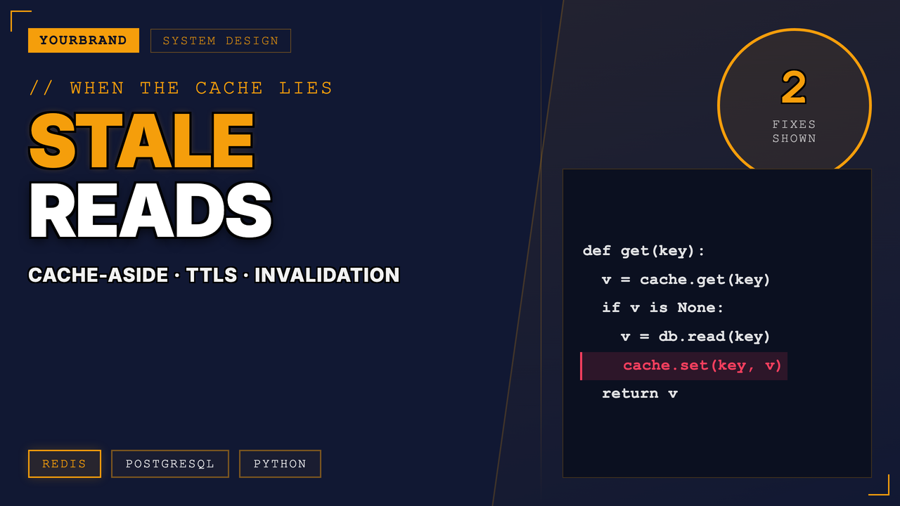

# Content Pipeline for Claude Code

A set of Claude Code **agents** and **skills** for running a technical blog and a
YouTube channel: research a topic, outline it, draft it with an independent review
loop, then produce the diagrams, the SEO package and the video assets.

The writer stays in charge. The pipeline proposes, drafts and checks; you choose the
topic, supply the opinions and experience only you have, approve every step, and
publish it yourself. Nothing is posted automatically.



---

## What's in here

| Component | Type | Does |
|---|---|---|
| `topic-scout` | agent | Finds gaps in your published archive, proposes topics, then researches and validates the one you pick |
| `video-scout` | agent | Cross-references your posts and published videos to find video gaps, then writes a concept deep-dive |
| `copy-reviewer` | agent | Independent reviewer: reads a draft cold, checks claims against sources, returns PASS or a numbered list of fixes |
| `blog-writer` | skill | Outline, draft and publishing package (per-platform titles, descriptions, tags and launch notes for your article) |
| `blog-images` | skill | Hand-written SVG diagrams and card-grid infographics from your palette, rendered to PNG |
| `video-scriptwriter` | skill | Video script, coding prompts to record, YouTube SEO and a Shorts cut |
| `video-thumbnail` | skill | Renders a 1280x720 thumbnail from a branded HTML template |
| `video-shorts` | skill | Renders a vertical Short (1080x1920 MP4) from a voiceover and a small JSON spec, with a Remotion template |

**Agents** handle research. They run in an isolated context, so fifteen web searches
don't bury your draft. **Skills** handle writing and rendering, in your main
conversation where the context lives.

None of the image or video renderers is an AI image model. They are deterministic
templates, because generated images drift in style between runs and a blog's diagrams
and a channel's thumbnails need to look like a set.

---

## How it keeps the writing honest

- **`[NEEDS: ...]` markers.** Anything only the author knows (an opinion, a war
  story, a version number, a source to cite) is left as a marker. The pipeline never
  fills it with a plausible guess.
- **An independent reviewer.** Every draft, script and piece of launch copy goes
  through `copy-reviewer`, a fresh agent that never sees the writer's reasoning. It
  lists every factual claim and checks it against docs or the cited source; training
  memory doesn't count as a source. The loop runs until it passes, with a round limit
  (5 for articles, 3 for scripts); anything still open goes back to you.
- **The reviewer is measured too.** `copy-reviewer` is an LLM judge, so it has its
  own eval set in [`evals/copy-reviewer/`](evals/copy-reviewer/README.md): cases with
  verdicts you label, rerun whenever its prompt or model changes, with zero
  tolerance for a case that should fail getting through.
- **Honest framing.** `positioning.honestFraming` in config says how your experience
  may be described and lists claims never to make, so nothing goes out that you
  couldn't defend when a reader asks a follow-up question.
- **Content limits.** List your own rule files (for example obligations from a job
  or a client) in `contentLimits.files`. Every skill reads them before writing. Even
  without them, a baseline applies: no material from your job, nothing that names an
  employer or client, and any novel technique flagged for you to clear.

---

## Setup

```bash
git clone https://github.com/AIDevBuilds/claude-content-pipeline.git
cd claude-content-pipeline
./setup.sh
```

`setup.sh` creates one shared `.venv`, installs the Python dependencies, fetches
Chromium for Playwright, and seeds `config.json` from the example.

Extra system dependencies:

| Needed for | Install |
|---|---|
| Diagrams (`blog-images`) | the native **cairo** library: `brew install cairo` (macOS) or `sudo apt-get install libcairo2` (Debian/Ubuntu) |
| Shorts (`video-shorts`) | **Node.js** and **ffmpeg/ffprobe**, then `cd .claude/skills/video-shorts && npm install` |
| Shorts voiceover | an **ElevenLabs** account connected to Claude (optional; any mp3 voiceover works) |

Then edit **`config.json`**: brand name, author, channel URLs, series, colours. It is
gitignored, so your values stay yours. `config.example.json` documents every field.

### Optional: set the level your content works at

The `positioning` block turns "suggest good topics" into "suggest topics that show
expertise at the level I write for":

```jsonc
"positioning": {
  "targetLevel":     "e.g. a seniority plus a specialty",
  "audienceSeniority": "senior engineers, tech leads and architects",
  "altitude":        { "write": [...], "avoid": ["step-by-step build tutorials"] },
  "provenStrengths": [ "things you have genuinely done" ],
  "evidenceGaps":    [ { "skill": "a capability you are building", "priority": "highest" } ],
  "honestFraming":   { "useThis": "...", "neverClaim": [...] }
}
```

With it set, the scouts reject topics matching `altitude.avoid` however well they'd
perform, weight suggestions toward your `evidenceGaps`, and say which gap each
candidate closes. The writing skills hold that altitude. Delete the block for
level-agnostic suggestions.

---

## Using it

Open Claude Code in the repo and talk to it.

**Blog:**
```
Use topic-scout to suggest my next blog post
Use topic-scout to research and validate: <the one you picked>
Using the blog-writer skill, turn this research brief into an outline
The outline looks good, write the full draft
This draft is final, give me the SEO and publish details
```

**Video:**
```
Use video-scout to suggest my next video
Use video-scout to research and validate: <the one you picked>
Using the video-scriptwriter skill, write the full script
Give me the YouTube SEO and thumbnail details
Also generate the Shorts package from this
```

Step-by-step guides: [blog](docs/WORKFLOW.md), [video](docs/VIDEO_WORKFLOW.md),
[making a Short](docs/HOW_TO_MAKE_A_SHORT.md), and
[which model each skill uses](docs/MODELS.md).

---

## Where things live

```
.claude/
  agents/            research and review agents
  skills/<skill>/    SKILL.md, scripts/, references/, assets/, examples/
  hooks/             guard_secrets.py (see Security)
  settings.json      permission rules and the hook
docs/                workflow guides
evals/               eval cases for the copy-reviewer judge
config.example.json  template for your config.json
blog-data/           your posts and diagrams     (gitignored)
video-data/          your scripts, thumbnails, Shorts; .cache/ is render scratch (gitignored)
private/             your own rule files and notes (gitignored)
```

Skill folders hold code and fixed assets only; nothing is written into them while
running. Your content stays in the gitignored data folders: this is a tooling repo.

---

## Security

Two independent layers stop an agent reading credentials, both in
`.claude/settings.json`:

1. **`permissions.deny`** blocks the Read tool from `.env`, SSH keys, cloud
   credentials, `.npmrc`/`.pypirc`, `secrets/` and certificate files.
2. **A `PreToolUse` hook** (`.claude/hooks/guard_secrets.py`) inspects every shell
   command and refuses anything touching those paths, closing the `cat .env` gap that
   permission rules alone leave open. It has its own test suite, run in CI.

A third layer protects what you publish: **`scripts/pre-commit`** refuses a commit
that stages a private path (`private/`, `blog-data/`, `video-data/`, `config.json`)
or any personal term: your values from `config.json` plus anything you list in
`private/public-denylist.txt`. Git never copies hooks, so install it once per clone:

```bash
ln -sf ../../scripts/pre-commit .git/hooks/pre-commit
```

The `*.example` files stay readable, so the agent can see what shape a config takes
without seeing a real value. No API key is required. `YOUTUBE_API_KEY` is optional
and only adds view counts to video topic suggestions; without it `video-scout` uses
`yt-dlp`.

---

## Using a skill outside this repo

Each skill folder is self-contained. To use one globally:

```bash
cp -r .claude/skills/blog-writer ~/.claude/skills/
```

Scripts prefer this repo's `.venv` and fall back to system `python3`. Skills that
read `config.json` expect it at the repo root, so a copied skill needs one nearby.

---

## License

MIT. Adapt it, rebrand it, ship it. Icons are from [Lucide](https://lucide.dev)
(ISC licence, included).
